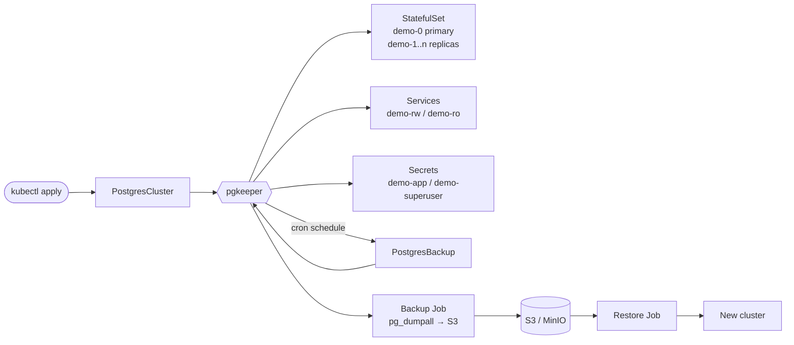

# pgkeeper

[](https://github.com/mahmudft/pgkeeper/actions/workflows/ci.yml)
[](go.mod)
[](LICENSE)

A small Kubernetes operator, written in Go, that runs PostgreSQL clusters. It handles streaming replicas, scheduled backups to S3-compatible storage, and restore into a new cluster.

```yaml
apiVersion: postgres.pgkeeper.dev/v1alpha1
kind: PostgresCluster
metadata:
  name: demo
spec:
  version: "16"
  instances: 2            # 1 primary + 1 streaming replica
  storage:
    size: 1Gi
  backup:
    schedule: "0 */6 * * *"
    s3:
      endpoint: http://minio.minio.svc:9000
      bucket: pg-backups
      credentialsSecret:
        name: s3-credentials
```

```console
$ kubectl get pgc
NAME   VERSION   INSTANCES   READY   PHASE   AGE
demo   16        2           2       Ready   3m
```

## Features

- **Declarative clusters.** A `PostgresCluster` becomes a StatefulSet, services, generated credentials and init scripts.
- **Streaming replicas.** Instance 0 is the primary. Other instances are cloned with `pg_basebackup` and follow it as hot standbys. Scaling `spec.instances` adds or removes replicas.
- **Connection services.** `<name>-rw` always points at the primary. `<name>-ro` balances across all instances.
- **Credentials.** The `<name>-app` secret holds `username`, `password`, `dbname`, `host`, `port` and a ready-to-use `uri`.
- **Backups.** A `PostgresBackup` runs `pg_dumpall` and uploads the gzipped dump to S3, MinIO or any S3-compatible storage.
  - Scheduled backups use a cron expression. Each run creates a `PostgresBackup` object, so the history is visible with `kubectl get pgb`.
  - Retention works at two levels: S3 objects older than `retentionDays` are removed, and only `historyLimit` backup objects are kept in the cluster.
- **Restore.** `spec.bootstrap.fromBackup` creates a new cluster from a backup object.
- **Volume expansion.** Increasing `spec.storage.size` resizes the existing PVCs.
- **Admission webhook.** Invalid cron expressions, major version changes, shrinking volumes and changes to immutable fields are rejected before they reach the controller.
- **Observability.**
  - Status phase, conditions and Kubernetes events.
  - Operator metrics: `pgkeeper_cluster_ready_instances`, `pgkeeper_backups_total`, `pgkeeper_backup_duration_seconds` and more.
  - An optional `postgres_exporter` sidecar per instance.
- **Secure defaults.** Pods run as non-root with a RuntimeDefault seccomp profile and no added capabilities. Anti-affinity spreads instances across nodes.

## How it works



The controllers follow the usual reconcile pattern:

1. **PostgresCluster controller.** Creates or updates every owned object, grows volumes and drives the one-time restore Job. It also creates scheduled `PostgresBackup` objects, prunes old ones and reports status, conditions and metrics. Every step is idempotent, so a reconcile can run any number of times.
2. **PostgresBackup controller.** Starts a Job (a `pg_dumpall` init container followed by an `aws s3 cp` upload), mirrors the Job state into the backup status and records the result on the cluster.

All managed objects carry owner references, so deleting a cluster cleans everything up. PVCs are retained on purpose to protect data.

## Quick start (kind)

You need [kind](https://kind.sigs.k8s.io/), [helm](https://helm.sh/), `kubectl` and Docker.

```sh
kind create cluster --name pgkeeper

# cert-manager issues the webhook certificate
kubectl apply -f https://github.com/cert-manager/cert-manager/releases/download/v1.17.2/cert-manager.yaml
kubectl -n cert-manager wait deploy --all --for=condition=Available --timeout=300s

# demo object storage
kubectl apply -f hack/minio.yaml

# build and install the operator
docker build -t pgkeeper:dev .
kind load docker-image pgkeeper:dev --name pgkeeper
helm install pgkeeper charts/pgkeeper -n pgkeeper-system --create-namespace \
  --set image.repository=pgkeeper --set image.tag=dev --set image.pullPolicy=Never

# create a cluster
kubectl apply -k config/samples
kubectl get pgc -w
```

Connect to it:

```sh
kubectl exec -it demo-0 -c postgres -- psql -U postgres -d shop
# or as the application user
kubectl exec -it demo-0 -c postgres -- psql "$(kubectl get secret demo-app -o jsonpath='{.data.uri}' | base64 -d)"
```

Take a backup and restore it into a new cluster:

```sh
kubectl apply -f config/samples/postgres_v1alpha1_postgresbackup.yaml
kubectl get pgb -w
kubectl get pgb demo-manual -o jsonpath='{.status.objectKey}'

# set objectKey in the file, then:
kubectl apply -f config/samples/postgres_v1alpha1_restore.yaml
kubectl get pgc demo-restored -w
```

`hack/e2e.sh` runs this whole flow automatically: install, replication check, backup, restore, scale-out and metrics. CI runs it on every push.

## API

### PostgresCluster (`pgc`)

| Field | Default | Description |
|---|---|---|
| `spec.version` | `16` | Major version: `14`, `15`, `16` or `17`. Immutable. |
| `spec.image` | `postgres:<version>` | Custom image. Must be compatible with the official image. |
| `spec.instances` | `1` | 1–5. Instance 0 is the primary. |
| `spec.storage.size` | required | Volume size per instance. Can only grow. |
| `spec.storage.storageClassName` | cluster default | Immutable. |
| `spec.resources` | none | Resources for the postgres container. |
| `spec.database.name` / `owner` | `app` / `app` | Created on first start. Immutable. |
| `spec.monitoring.enableExporter` | `false` | Adds a `postgres_exporter` sidecar on port 9187. |
| `spec.backup.schedule` | none | Cron expression, for example `0 2 * * *` or `@daily`. |
| `spec.backup.retentionDays` | `7` | S3 objects older than this are deleted after each backup. |
| `spec.backup.historyLimit` | `5` | Finished scheduled `PostgresBackup` objects to keep. |
| `spec.backup.s3` | none | `endpoint`, `bucket`, `path`, `region` and `credentialsSecret`. The secret needs the keys `ACCESS_KEY_ID` and `SECRET_ACCESS_KEY`. |
| `spec.bootstrap.fromBackup.objectKey` | none | Restore from this object in `spec.backup.s3`. |

Status fields: `phase` (`Provisioning`, `Restoring`, `Ready`, `Degraded`), `readyInstances`, `primaryEndpoint`, `replicaEndpoint`, `appSecret`, `lastSuccessfulBackup`, and the conditions `Ready`, `Restored` and `BackupScheduled`.

### PostgresBackup (`pgb`)

| Field | Description |
|---|---|
| `spec.cluster` | Name of the cluster in the same namespace. Immutable. |
| `status.phase` | `Running`, `Completed` or `Failed`. |
| `status.objectKey` | Object key in the bucket: `<path>/<namespace>/<cluster>/<backup>.sql.gz`. |

## Development

```sh
make help          # list targets
make test          # fmt, vet, unit tests
make manifests     # regenerate CRDs, RBAC and webhook manifests
make generate      # regenerate DeepCopy code
make run           # run against the current kube context (webhooks off)
make e2e IMG=...   # run hack/e2e.sh against the current kube context
```

Project layout:

```text
api/v1alpha1/          CRD types
internal/controller/   reconcilers, resource builders, scheduling, metrics
internal/webhook/      validating admission webhook
cmd/main.go            manager entrypoint
charts/pgkeeper/       Helm chart
config/                kustomize manifests and samples
hack/                  e2e script and demo MinIO
```

## Limitations and roadmap

This is a compact project for learning and demos, not a replacement for CloudNativePG or Zalando's operator.

- [ ] Automatic failover. Today, if the primary pod dies, the StatefulSet restarts it and replicas reconnect, but no replica is promoted.
- [ ] Physical backups with WAL archiving and point-in-time recovery. Backups are currently logical (`pg_dumpall`).
- [ ] TLS for client connections.
- [ ] Minor version rolling updates with a switchover.
- [ ] Deleting S3 objects when a `PostgresBackup` is deleted.

## License

[MIT](LICENSE)
